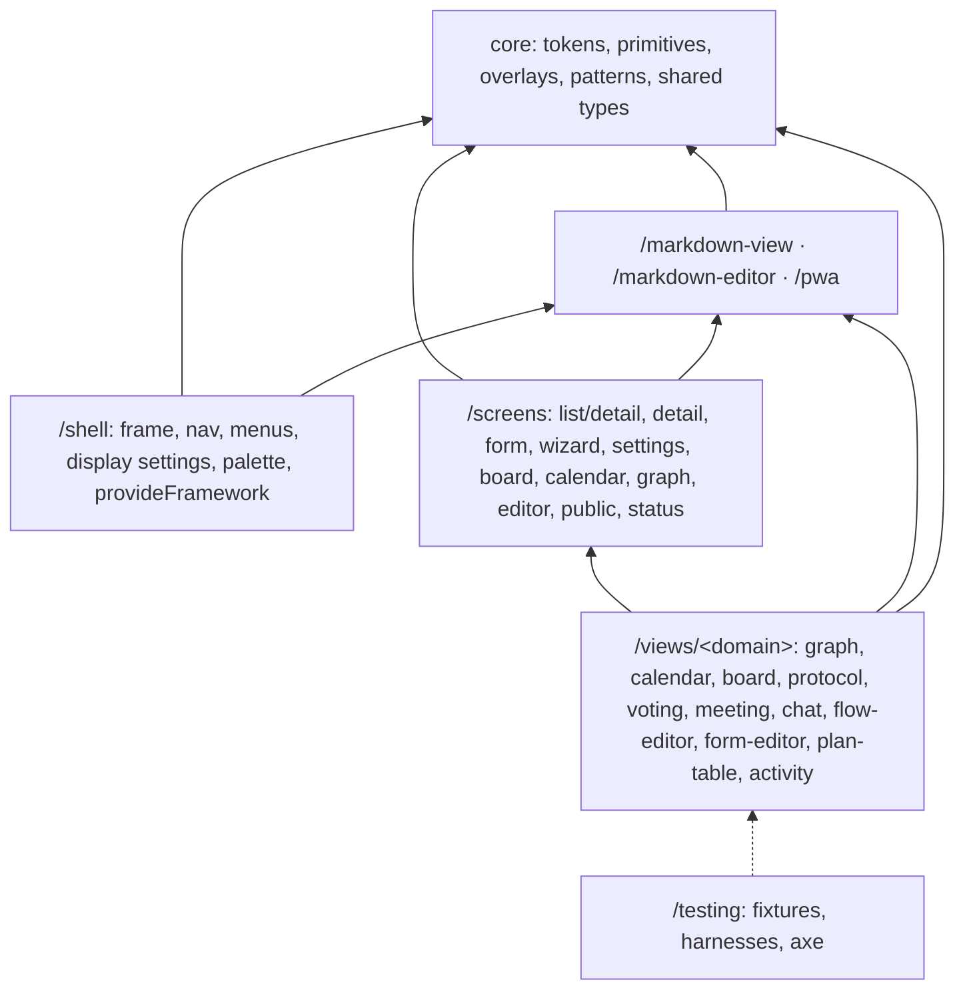
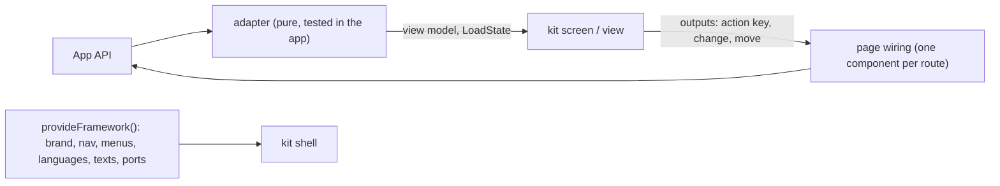

# The kit as a framework

This page gives the overview. The binding rules are the specs in `specs/style/framework/`; each
section names them.

## Goal

An app is configuration, adapters and routes. Everything a person sees comes from the kit: the
shell, the screens, the controls and the domain views. An app has no stylesheet (002205), so all
apps have the same structure, look and UI and UX features (002200, 002206).

## Layers (002214, 002215)

An arrow points to the layer that is imported. A view never imports another view.

## What an app writes

- **Config** (002207, 002225, 002226): one `provideFramework()` with brand, navigation, menus,
  languages, text overrides and the ports `session`, `search`, `avatar`, `navMarks`, `report`,
  `upload`, `live`.
- **Routes** (002224): `listDetailRoutes()` and `screenRoute()` set the title, the motion and the
  focus.
- **Page wiring** (002200, 002217): one component per route. Its template is one screen with data
  bindings and slots that hold only kit components.
- **Adapters** (002204, 002228): pure functions from the API data to the view models of the kit.

## How a screen is filled (002216 to 002221)

- The frame is data: `ScreenHead`, `Action[]`, `ScreenTab[]`, `FilterDef[]`, `SortDef[]`,
  `ListRow[]`, `LoadState<T>`.
- The content of a region is a slot: `<ng-template screenTab="history">…</ng-template>`.
- An action says what it is (`kind`) and how important it is (`priority`). The kit puts it into
  the head group, the ⋮ menu, a FAB or the phone menu, and asks its confirm question.
- The kit holds UI state (open sheet, tab, scroll, selection, drag, draft). The app holds the
  data; the kit emits changes and follows the inputs.
- The list/detail screen keeps the open row, the search, the filters, the sort and the tab in the
  URL.

## Forms (002222)

`app-form` renders a `FormDef`: sections and fields of fixed kinds. The app computes visibility
and the disabled state and gives the server errors by field key. A wizard uses the sections as
steps.

## Domain views (002203, 002227)

Each view has a contract spec (inputs, outputs, texts, states) before it is built. The first
contracts are in 002227.

## Texts and themes (002208, 002223, 002207)

Content texts come from the app through inputs. Control texts have `kit.*` keys with DE and EN,
and an app overrides them through `provideFramework()`, also from its admin page for UI texts.
The kit owns the light and dark themes and the accessibility modes; an app sets only the accent
colour and the logos.

## Tests and the showcase (002209, 002228, 002229)

The kit tests every component with the fixtures of `/testing` in the themes and in very high
contrast, and shows every screen and view in the showcase. An app tests its adapters and its
route wiring. A change of a public kit API ships with the pull request of every consumer.

## Migration (002210 to 002213)

`specs/MIGRATION.md` lists the specs that move from STUPA-Workflow. The style lines of an app may
only fall until they reach zero (002213). The order: shell config and screens on every page
first, then the domain views one by one, then the Spec-Explorer as the second app.
